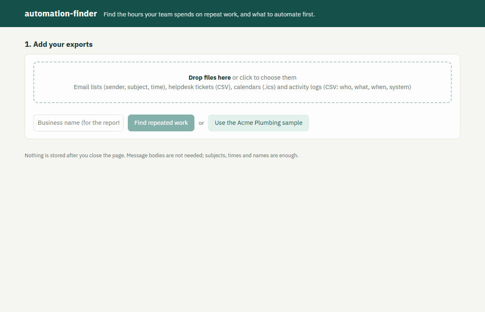
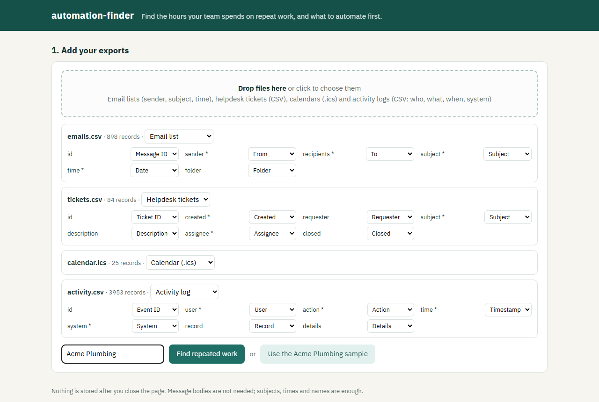
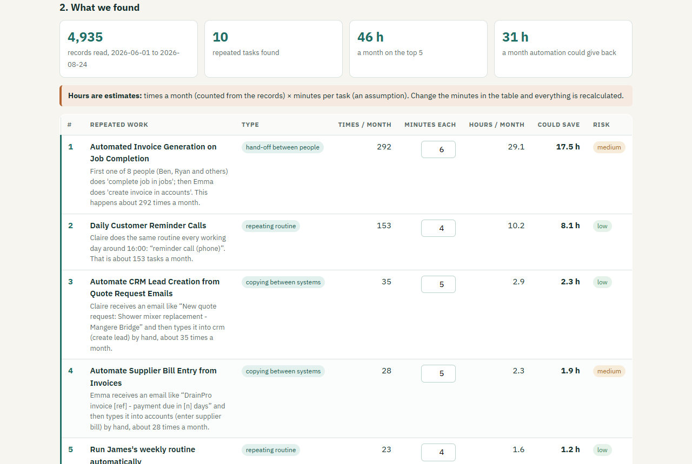
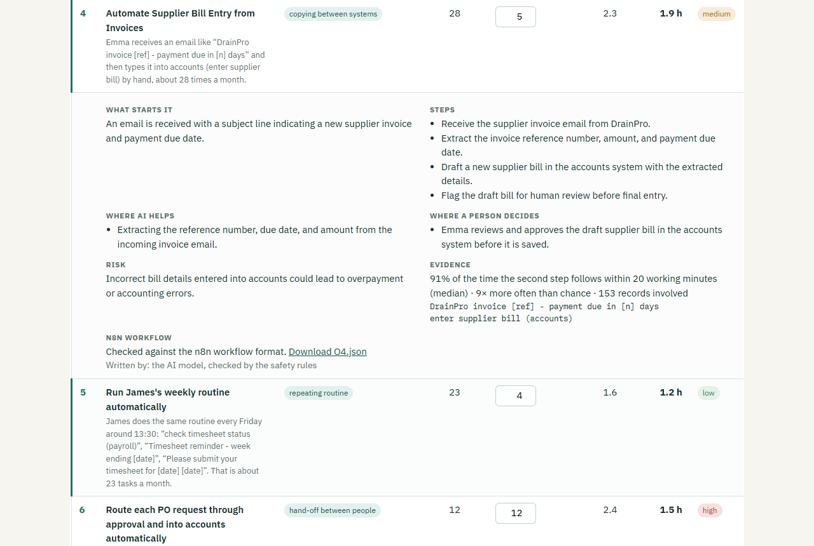
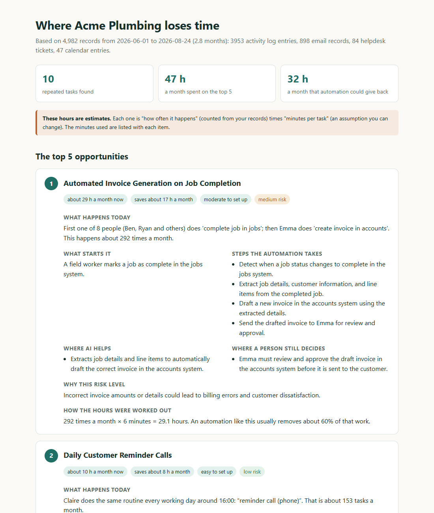
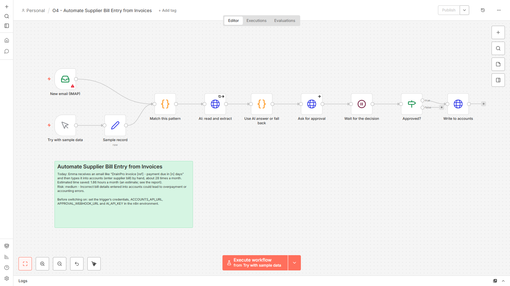
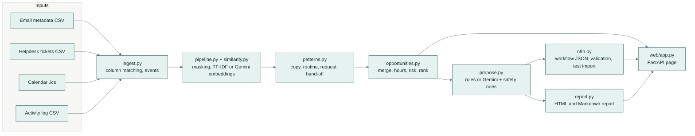
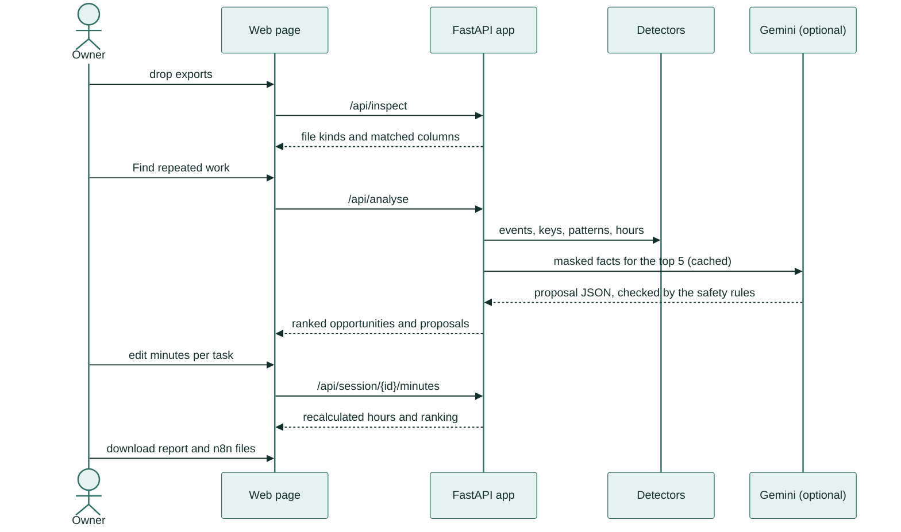
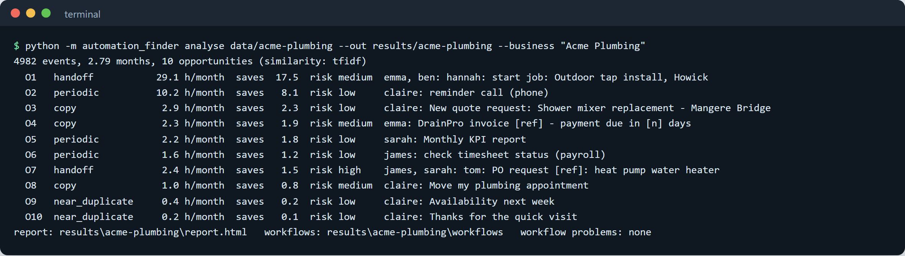

# automation-finder

Finds the repeated manual work hiding in a business's everyday records, estimates how many hours it costs, and
drafts the automation for each one, including a workflow file you can import into n8n.



*The demo: the sample business is loaded, its repeated tasks appear ranked by hours, one time estimate is changed
(the totals update), and one proposal is opened to show its steps, where AI helps and where a person still decides.*

## What it does

You give it the records a small business already has: a list of emails (who, subject, when), helpdesk tickets,
the shared calendar and the activity log of its business software. It looks for work people do again and again by
hand, such as typing the same details from one system into another, chasing the same thing every Friday, or passing
the same kind of request between three people. It then tells you, in plain words, which jobs are worth automating
first and how each one would work.

## A real-life example

**Sarah Mitchell owns Acme Plumbing, a 12-person plumbing business.** Her team is always busy, but she can't say
where the office hours go. Emma in accounts types every finished job into the accounts system as an invoice, Claire
copies website quote requests into the customer list, James chases timesheets every Friday, and Sarah spends a
morning each month building the same report.

Sarah exports twelve weeks of email lists, tickets, calendar and system logs and drops them into automation-finder.
A minute later she has a ranked list: invoicing finished jobs takes about **29 hours a month**, reminder calls about
**10 hours**, and the top five together about **47 hours a month**, of which roughly **32 hours** could be handed to
automations. Each item says what would trigger it, the steps, where AI helps, where a person must still approve, and
how risky it is. She gives the report and the workflow files to her IT contractor and starts with the two easiest.

*(Acme Plumbing and its staff are invented. The data is generated by this project, with known repeated tasks planted
in it so the results can be checked.)*

## How you would use it

1. Export your records: the email list from your mail system, tickets from the helpdesk, the calendar as an .ics
   file, and the activity or audit log from your business software. Subjects and times are enough; no message text
   is needed.
2. Open automation-finder in your browser and drop the files in. It recognises each file and matches the columns;
   if a column has an unusual name, pick it from the list.
3. Press **Find repeated work**. You get a table of repeated tasks, the biggest time savers first.
4. Check the minutes. Each figure is "times a month" multiplied by "minutes per task"; if a task takes longer or
   shorter in your business, type the right number and every total updates.
5. Click a row to read the proposal, then download the report (it prints to PDF) and the workflow files for the top
   five.

| | |
|---|---|
|  |  |
| *Step 1: four exports dropped in. Each one is recognised and its columns are matched automatically; a starred field must be filled.* | *Step 2: the repeated work, ranked. Times a month come from the records; the minutes column is an editable estimate.* |
|  |  |
| *A proposal opened: the trigger, the steps, the AI's part, the person's approval, the risk and the evidence behind it.* | *The report for the owner, with every estimate explained. It can be saved as a web page or printed to PDF.* |



*The workflow file for "supplier bill entry", imported into n8n (an automation tool): a new email starts it, the AI
reads the invoice, Emma approves the draft, then the bill is written to the accounts system. A "Try with sample
data" button lets anyone run it straight away.*

---

## Key features

- **Four kinds of input** with automatic column matching: email metadata, helpdesk tickets (CSV), calendars (.ics,
  including repeating entries) and activity logs (CSV).
- **Four detectors** for repeated work: near-duplicate requests, regular routines (daily, weekly, monthly), copying
  between systems, and hand-offs or approval chains between people.
- **Hours estimate** per task: frequency counted from the data times an editable minutes-per-task assumption.
- **Proposals** with trigger, steps, AI help, human approval, risk level and hours saved, written by rules or by
  Gemini (an AI model), with safety rules that the model cannot override.
- **n8n workflow files** for the top five, checked against n8n's workflow structure and test-imported into a real
  n8n.
- **Works without any API key:** text similarity has a built-in mode, and stored model answers replay offline.

## How it works

1. **Read and normalise.** Every row from every file becomes one *event*: who did it, when, in which system, and a
   short text (an email subject, a ticket title, an action like "enter supplier bill").
2. **Name each kind of event.** Ids, amounts, dates and names are masked ("Invoice INV-48213" becomes "invoice
   &lt;ref&gt;"), then texts that mean the same are grouped. Grouping uses TF-IDF (word-overlap scoring) by default,
   or Gemini embeddings (number vectors that capture meaning) to also group differently worded requests. Mail from a
   frequent outside sender, such as a supplier's billing system, is grouped by sender first.
3. **Run the detectors.**
   - *Copy between systems:* something arrives in system A and the same person enters a record in system B within
     45 working minutes. The pair must happen at least 6 times, follow at least half the time, and be 3 times more
     common than chance (so an action someone does all day anyway is not mistaken for a copy).
   - *Routines:* the same person does the same action on most working days, the same weekday, or the first or last
     working day of each month, at a steady time of day. Meetings with other people are left out.
   - *Requests:* tickets, and incoming emails that get replies, that keep arriving in the same group.
   - *Hand-offs:* events that share a reference such as PO-2041 or J-5521 are chained in time order; the same route
     between people, repeated, is a hand-off. Approval words mark approval chains.
4. **Merge and estimate.** Parts of one routine are added together, and the same work seen by two detectors is
   counted once. Hours per month = times a month x minutes per task (a stated model, editable in the page).
5. **Rank and assess risk.** Opportunities are ranked by hours saved, weighted by how easy they are to set up. Risk
   is high when money is committed (an approval exists today), medium when financial or customer records are
   written or changed, and low otherwise.
6. **Propose and build.** Each top opportunity gets a proposal and an n8n workflow: the right trigger, a filter for
   this pattern, an AI step that falls back instead of failing, an approval wait where needed, and the write step.





## Evaluation

The finder is measured on invented data with known answers. The generator (`automation_finder/sample.py`) writes
twelve weeks of activity for Acme Plumbing with **8 planted automatable patterns**, **4 recurring distractors** that
are not automatable work (a team meeting, a newsletter, a system notification, a one-to-one) and noise. Every planted
task records how many minutes it really took, which gives a true hours figure. Thresholds were tuned on seed 0 only;
the numbers below are the mean over seeds 1-5. Full tables are in [results/RESULTS.md](results/RESULTS.md) and the
method in [docs/evaluation.md](docs/evaluation.md).

| Method | Pattern recall | Precision | Top-5 precision | Event recall | Hours error |
|---|---:|---:|---:|---:|---:|
| automation-finder, TF-IDF (no model) | 100% | 78% | 100% | 88% | 24% |
| automation-finder, Gemini embeddings | 100% | 82% | 100% | 96% | 14% |
| Baseline: top-10 keyword counts | 12% | 10% | 20% | 8% | 101% |
| Baseline: top-10 exact repeats | 50% | 40% | 40% | 29% | 24% |

- **Pattern recall:** planted patterns found (a found item must be at least half made of that pattern's records and
  cover at least a quarter of them). **Precision:** found items that are a planted pattern; a second fragment of the
  same pattern counts as wrong. **Event recall:** share of the planted records captured. **Hours error:** mean
  absolute percentage error of the estimated hours per month against the planted truth.
- The embeddings matter most for the requests worded in many ways ("Can we move Thursday's booking?", "Need a
  different day for the job"): TF-IDF captures 49% of them, the embeddings 100%.
- On **harder data** (half the volume, only 60% of copies typed in on time, routines starting up to an hour earlier
  or later) recall is 82% with TF-IDF and 100% with embeddings; precision drops to 61% and 73%.
- **Proposal quality**, scored with a fixed rubric against labelled expected automations (40 proposals): the
  rule-based writer scores 98%, Gemini 92%, and Gemini with the safety rules 93%. The model writes clearer, more
  specific steps, but on this rubric it does not beat the rules: it adds a person's approval to low-risk routines
  (the monthly report, reminders) more often than the labels expect. It never dropped an approval that money
  needed.
- **n8n:** all 5 generated workflows imported into n8n 2.8.4 and exported back with every node intact.
- All numbers replay offline from `eval-cache/`, which holds 39 stored model answers and 667 embedded texts.

## Tech stack

- Python 3.11+, FastAPI and Uvicorn for the web app, Jinja2 for the report, vanilla HTML/JS for the page.
- scikit-learn (TF-IDF, agglomerative clustering), NumPy, python-dateutil (calendar repeats).
- Gemini through its OpenAI-compatible API: `gemini-flash-lite-latest` for proposals and `gemini-embedding-001`
  (256 dimensions) for embeddings, both optional and cached.
- n8n 2.8.4 for the workflow test import.
- pytest, ruff, mypy, GitHub Actions.

## Setup

```bash
python -m venv .venv
.venv/Scripts/activate            # Windows; on macOS/Linux: source .venv/bin/activate
pip install -e ".[dev]"
```

**Run the demo** (sample data, analysis and the web app at http://127.0.0.1:8000):

```bash
python -m automation_finder demo
```

Then press **Use the Acme Plumbing sample**, or drop your own exports.

### Configuration

All optional; see `.env.example`. Without them everything runs on the rules and the stored answers.

| Variable | Used for |
|---|---|
| `AI_API_KEY` | Gemini key for live proposals (`--model live`) and live embeddings (`--live`) |
| `AI_BASE_URL`, `AI_MODEL` | Another OpenAI-compatible endpoint or model |
| `AI_MIN_INTERVAL`, `EMBED_MIN_INTERVAL` | Seconds between model calls and between embedding batches |
| `N8N_BIN` | Path to the n8n command for the test import |
| `N8N_NODES_DIR` | n8n's `n8n-nodes-base/dist/nodes` folder, for the node-version test |

### Commands

```bash
python -m automation_finder sample                      # write the Acme Plumbing exports to data/acme-plumbing
python -m automation_finder analyse data/acme-plumbing --out results/acme-plumbing --business "Acme Plumbing"
python -m automation_finder analyse my-exports/ --embed gemini --live --model live   # with a key
python -m automation_finder eval --seeds 1-5            # recall, precision and hours error vs the baselines
python -m automation_finder eval --seeds 1-5 --hard     # the same on harder data
python -m automation_finder eval-proposals --seeds 1-5  # proposal rubric, rules vs Gemini (replayed)
python -m automation_finder n8n-check results/acme-plumbing/workflows --import-test
python -m automation_finder serve --port 8000
```



## Project structure

```
automation_finder/
  ingest.py          exports -> events; column matching, .ics with repeats
  events.py          the event record, masking, working-time maths
  similarity.py      TF-IDF and Gemini embeddings (cached), clustering
  pipeline.py        keys per event, then the detectors and opportunities
  patterns.py        the four detectors
  opportunities.py   merging, time model, risk, ranking
  propose.py         rule-based and model proposals, safety rules
  n8n.py             workflow builder, structure check, test import
  report.py          owner report (templates/report.html) and Markdown
  baseline.py        keyword-count and exact-repeat baselines
  evaluate.py        scoring against the planted labels, proposal rubric
  results.py         writes results/RESULTS.md
  sample.py          the invented dataset with planted patterns
  llm.py             OpenAI-compatible chat client with replay cache
  web/app.py         FastAPI app; web/static/index.html is the page
  cli.py             command line
data/acme-plumbing/  sample exports and labels.json (seed 0)
eval-cache/          stored embeddings and model answers (offline replay)
results/             RESULTS.md, eval files, the sample report and workflows
scripts/screenshots.mjs  README screenshots and demo GIF from a real run
tests/               unit, end-to-end, web and replay tests
docs/                evaluation method and screenshots
```

## Tests

```bash
ruff check . && ruff format --check . && mypy automation_finder
python -m pytest -q
```

36 tests cover column matching, calendar repeats, masking, each detector (including the cases it must reject),
the risk rules, workflow validation (and that broken workflows are caught), the model fallback and safety rules,
the web API end to end, and a replay test that rebuilds seed 1 of the stored evaluation from the cache and checks
the numbers match. CI also replays the full evaluation and fails if `results/RESULTS.md` changes, and a second job
installs n8n and imports the generated workflows.

## Licence

MIT, see [LICENSE](LICENSE).
